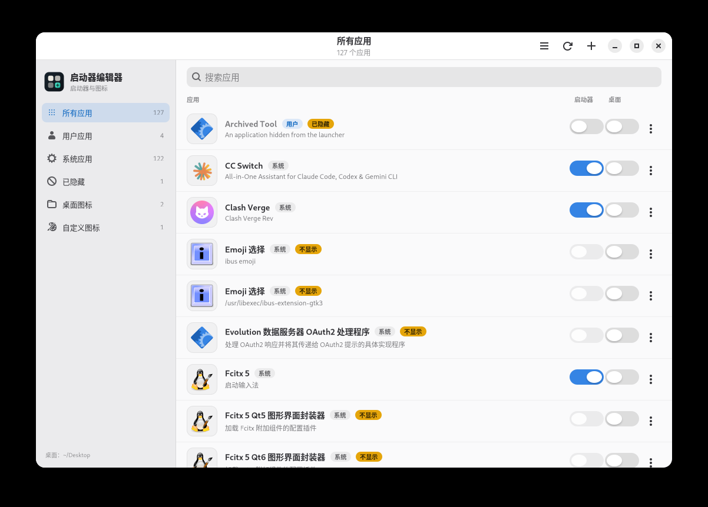

# 启动器编辑器 / Launcher Editor

一款面向 Linux 桌面的轻量工具，用来管理 Freedesktop `.desktop` 应用条目及其图标。

所有写操作只发生在你的用户目录，不需要 root，也不会修改软件包管理的系统文件。



## 功能介绍

- 从 XDG 数据目录、Flatpak 和 Snap 导出目录读取应用
- 区分「用户应用」和「系统应用」，系统应用只读
- 分别控制应用是否显示在启动器中、是否显示桌面图标
- 支持禁用/启用、删除用户应用
- 新建和编辑 `.desktop` 文件：
  - 常用字段图形化编辑
  - `[Desktop Entry]` 字段表
  - 完整源文件编辑，保留注释、未知字段和 actions
  - 保存前自动用 `desktop-file-validate` 校验
- 从已安装的主题图标中选择图标
- 导入 PNG、JPEG、WebP、SVG 图片，自动生成多尺寸 hicolor 图标
- 图标库管理，删除仍被应用使用的图标时会给出保护提示
- 中文 / 英文界面
- 轻量：deb 本体约 57 KB，安装后约 253 KB，不包含 GTK 运行库

## 安装

### 从 deb 安装（Debian / Ubuntu）

适用于 Ubuntu 22.04+、Debian 12+。

如果你已经取得发布包：

```bash
sudo apt install ./launcher-editor_0.1.0_all.deb
```

安装后可以从应用菜单启动，也可以在终端运行：

```bash
launcher-editor
```

卸载：

```bash
sudo apt remove launcher-editor
```

卸载不会删除你保存在 `~/.local/share/applications`、`~/.local/share/icons` 和桌面目录中的个人配置。

### 从源码运行

先安装运行依赖：

```bash
sudo apt install python3-gi gir1.2-gtk-4.0 gir1.2-adw-1 gir1.2-gdkpixbuf-2.0 desktop-file-utils xdg-user-dirs
```

获取源码并运行：

```bash
git clone https://github.com/ktmitax/LauncherEditor.git
cd LauncherEditor
PYTHONPATH=src python3 -m launcher_editor
```

如果希望保留中文界面，请确认系统语言为中文：

```bash
LANG=zh_CN.UTF-8 PYTHONPATH=src python3 -m launcher_editor
```

## 使用方法

### 主界面

左侧栏用于切换视图：

- **所有应用**：用户应用和系统应用
- **用户应用**：你可以在 `~/.local/share/applications` 中编辑的应用
- **系统应用**：由软件包、Flatpak 或 Snap 管理的应用，只读
- **已隐藏**：从启动器中隐藏的应用
- **桌面图标**：当前有桌面快捷方式的应用
- **自定义图标**：由本工具导入的图标库

顶部搜索框可以按应用名称、注释、命令、分类或 ID 搜索。

### 启动器和桌面开关

每个应用右侧有两个开关：

- **启动器**：控制应用是否出现在应用菜单/应用网格中
- **桌面**：控制是否在桌面目录生成一个可执行的 `.desktop` 快捷方式

两个开关相互独立。一个应用可以只显示在启动器、只显示在桌面，或者两者都显示。

桌面快捷方式会设置可执行位，并尽量写入 GNOME 的 trusted 元数据。GNOME 需要 Desktop Icons NG 之类的扩展才会显示桌面图标；KDE、XFCE 等通常原生支持。

### 新建和编辑应用

点击标题栏的 **+** 新建应用，或点击用户应用行末菜单中的 **编辑**。

编辑器分为三个视图：

- **详情**：名称、注释、命令、图标、分类、终端、启动通知等常用字段
- **字段**：直接编辑 `[Desktop Entry]` 的键值，包括额外字段
- **源文件**：编辑完整的 `.desktop` 文本，适合 actions、本地化字段和高级配置

保存前会校验文件。校验不通过时不会覆盖原文件。

编辑器中的 **应用 ID** 决定 `.desktop` 文件名，只允许字母、数字、点、下划线和连字符。

### 选择或导入图标

在编辑器的 **外观 → 图标** 中点击 **选择**：

- **主题图标**：从系统已安装的图标主题中选择
- **导入图片**：把图片转换为用户 hicolor 主题中的多尺寸图标
- **绝对路径**：直接引用图片文件；不推荐，文件移动后图标会失效

导入的图标保存在：

```text
~/.local/share/icons/hicolor
```

### 关于“NoDisplay字段”

编辑器 **详情 → 可见性** 中有一个 **NoDisplay字段**：

> 对系统可见而在菜单中隐藏，无视本工具的显示设置

它对应 `.desktop` 文件中的：

```ini
NoDisplay=true
```

含义是：应用仍然存在，也仍然可以被系统通过桌面图标、命令行、MIME 关联或 D-Bus 等方式启动，但应用菜单/启动器不会列出它。

它和主界面的“启动器”开关不同：

| | 启动器开关 | NoDisplay字段 |
|---|---|---|
| 写入字段 | `Hidden=true` | `NoDisplay=true` |
| 含义 | 用户主动禁用/隐藏 | 条目自身声明不在菜单中列出 |
| 应用是否仍可启动 | 是 | 是 |
| 桌面图标是否保留 | 是 | 是 |
| 系统应用是否可修改 | 通过用户覆盖隐藏 | 系统应用只读，不能修改 |

如果你只是想让应用从启动器消失，使用主界面的 **启动器** 开关即可。`NoDisplay` 更适合应用自己声明“不需要出现在菜单里”的场景，例如辅助程序、MIME 处理器或后台工具。

### 系统应用和用户应用

- **用户应用**：位于 `~/.local/share/applications`，可以编辑、禁用和删除
- **系统应用**：由软件包、Flatpak 或 Snap 提供，只读；只能隐藏/显示，不能编辑或删除

隐藏系统应用时，本工具会在用户应用目录写入一个很小的同名覆盖文件，不会改动 `/usr` 下的原文件，因此：

- 不需要 root
- 软件包升级不会覆盖你的隐藏状态
- 删除覆盖文件即可恢复显示

删除用户应用时，`.desktop` 文件会移入回收站，不会卸载软件包。

### 图标库

左侧栏的 **自定义图标** 页面列出由本工具导入的图标，可以查看尺寸、使用情况并删除。

如果图标仍被某个应用使用，删除会被阻止。请先在对应应用中换掉图标。

## 数据位置

| 内容 | 位置 |
|---|---|
| 用户应用 | `~/.local/share/applications` |
| 系统应用隐藏覆盖 | `~/.local/share/applications` |
| 自定义图标 | `~/.local/share/icons/hicolor` |
| 图标清单 | `~/.local/share/launcher-editor/icons.json` |
| 窗口与筛选偏好 | `~/.config/launcher-editor/config.json` |
| 桌面快捷方式 | `$XDG_DESKTOP_DIR`，通常是 `~/桌面` 或 `~/Desktop` |

本工具不会访问网络，不会启动后台服务，也不会请求 root 权限。

## 常见问题

### 桌面开关已打开，但桌面上没有图标

GNOME 默认不显示桌面图标，需要安装并启用 Desktop Icons NG 等扩展。KDE、XFCE、Cinnamon 等通常自带桌面图标支持。

另外请确认应用的“桌面”开关确实处于打开状态，并检查 `$XDG_DESKTOP_DIR` 指向的目录。

### 为什么不能编辑或删除系统应用？

系统应用的文件由软件包管理器管理。直接修改会在升级时被覆盖，也可能破坏系统完整性。本工具对系统应用只提供隐藏/显示和桌面快捷方式开关。

### 为什么某个开关是灰的？

- 系统应用带有 `NoDisplay=true` 时，启动器开关不可用
- 仅存在于桌面的 `.desktop` 文件，启动器开关不可用；可以在行末菜单中选择“添加到启动器”
- 以 `NoDisplay=true` 的应用不会出现在应用菜单中，但文件仍然有效

### 修改后没有立即生效

本工具会在保存后刷新自己的列表，并调用 `update-desktop-database`。如果桌面环境仍然缓存了旧菜单，可以注销并重新登录，或刷新桌面环境。

## 兼容性

- Ubuntu 22.04+ / Debian 12+
- GTK 4.6+
- libadwaita 1.1+
- Python 3.10+
- 代码按 GTK 4.6 + libadwaita 1.1 API 编写，兼顾较老的受支持系统

## 项目信息

- 应用 ID：`io.github.ktmitax.LauncherEditor`
- 主页：https://github.com/ktmitax/LauncherEditor
- 维护者：ktmitax
- 许可证：GPL-3.0-or-later，详见 [LICENSE](LICENSE)

本软件由 **DeepSeek Harness** 和 **DeepSeek-V4.1-Flash** 开发。
